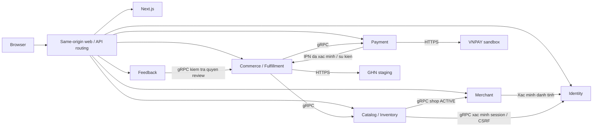

# Agora — Kiến trúc hệ thống v0.3

Ngày cập nhật: 2026-10-24. M1, Catalog M2a và ảnh Cloudinary M2b1 đã nghiệm thu local. M2b2 công bố/ẩn có backend/UI và proof trước pause (root verify 10:57:21 +07:00 ngày 24/10 đạt 133 tests); sau resume frontend build/lint/typecheck, 86 unit và 144 fixture production (19 regression revalidation mới) đã PASS. Hai asset trước pause exact lookup provider all_missing=true/exit 0; P2 fixed/review accepted, final static review clear; normal live 4/4 (6.7s) và media/publication live 2/2 (8.2s) PASS. M2b2 đã nghiệm thu local ngày 24/10/2026 khoảng 15:40 +07:00 sau main xác minh hai asset mới DB DELETED/0 relation và independent exact provider lookup 2 asset all_missing=true/exit 0. Nghiệm thu local không phải production hoặc CI run. Các service sau còn ở mức thiết kế. [ADR-0001](../decisions/0001-foundation.md) ghi nền tảng, [ADR-0002](../decisions/0002-separate-identity-merchant.md) chốt tách Identity/Merchant và [ADR-0003](../decisions/0003-postgresql-only.md) chốt PostgreSQL cho toàn bộ dữ liệu ứng dụng.

## 1. Đích kiến trúc và phần triển khai đầu tiên

| Ứng dụng | Context | Dữ liệu sở hữu | Bắt đầu |
|---|---|---|---|
| identity-service | Identity/Access | PostgreSQL local agora; schema identity | Đã triển khai M1 |
| merchant-service | Merchant | PostgreSQL agora_merchant; schema merchant | Đã triển khai M1 |
| catalog-service | Catalog/Inventory | PostgreSQL agora_catalog; schema catalog | M2a/M2b1 đã nghiệm thu; P2 review accepted; 144 fixture/4 normal/2 media live PASS, M2b2 đã nghiệm thu local 24/10 khoảng 15:40 sau cleanup hai asset mới; M2c1 đã có nhập lô/khóa/mở; reservation chưa triển khai |
| commerce-service | Commerce, Fulfillment, Notification | PostgreSQL agora_commerce | Sau catalog |
| payment-service | Payment | PostgreSQL agora_payment | Thử sandbox sớm, tích hợp cùng checkout |
| feedback-service | Feedback | PostgreSQL agora_feedback; schema feedback, dự kiến | Sau đơn giao thành công |

Tất cả service dùng PostgreSQL; có thể chạy chung instance local nhưng database thuộc từng service. Local đang dùng role postgres theo yêu cầu, deployment phải có role riêng và quyền tối thiểu. Không join hoặc đọc bảng xuyên service. Context cùng process dùng interface module và giữ quyền sở hữu bảng.

Khởi tạo Identity trước rồi Merchant và web. Đích 6 service không buộc có 6 ứng dụng rỗng ngay. Local tái sử dụng PostgreSQL 16 có sẵn, không thay instance hoặc nâng cấp dữ liệu người dùng.

## 2. Luồng truy cập

Sơ đồ mô tả đích; edge là cấu hình routing, không phải service nghiệp vụ thứ sáu. Local dùng Next.js rewrites với tuyến cho phép; khi deploy mới chọn reverse proxy/TLS cụ thể. Không mở proxy tới URL tùy ý do client cung cấp.

Web gọi HTTP/JSON cùng origin dưới /api/v1. gRPC dành cho backend, không gọi gRPC thông thường trực tiếp từ trình duyệt. Chưa thêm BFF nghiệp vụ: quy tắc vẫn thuộc backend.

## 3. Đăng nhập và phân quyền

- Lát cắt 1 dùng Spring Security, Spring Session JDBC và cookie AGORA_SESSION: HttpOnly, SameSite=Lax, Path=/, Secure trên HTTPS; chỉ profile local HTTP được bỏ Secure.
- Session hết hạn sau 30 phút không hoạt động; đăng nhập đổi session ID; đăng xuất vô hiệu hóa session và xóa cookie. Không lưu session ID/token trong Zustand hoặc localStorage.
- CSRF giữ bật cho thao tác browser thay đổi dữ liệu, kể cả đăng ký/đăng nhập. Web lấy token từ GET /api/v1/auth/csrf và gửi X-CSRF-TOKEN; lấy token mới sau đăng nhập/đăng xuất.
- Mật khẩu dùng Argon2id qua PasswordEncoder; định dạng lưu có định danh encoder, tham số được benchmark khi triển khai. Không tự viết thuật toán.
- USER và ADMIN là vai trò tài khoản. Quyền bán hàng suy ra từ sở hữu shop và trạng thái shop, không nhận role từ form đăng ký.
- API admin/ownership được kiểm tra ở backend. Khóa tài khoản phải làm mất hiệu lực đăng nhập hiện có, không chỉ chặn lần login tiếp theo.
- Merchant đã dùng hợp đồng gRPC kiểm tra session/CSRF với Identity; service khác không đọc bảng session. Lưu lượng nội bộ cần giới hạn truy cập và TLS khi deploy. Không giả định mạng nội bộ tự đáng tin.
- Cách xác thực tập trung này tăng phụ thuộc khả dụng vào Identity và thêm một lời gọi cho request được bảo vệ; chấp nhận cho portfolio. Identity không truy cập được thì từ chối an toàn, không bỏ kiểm tra.

## 4. Giao tiếp, giao dịch và phục hồi

- gRPC đồng bộ cho lấy báo giá, giữ/phân bổ hàng và yêu cầu hành động cần phản hồi; đặt deadline, không retry mù thao tác có side effect.
- Chọn RabbitMQ cho sự kiện khi bắt đầu tương tác liên service; chưa là dependency chạy của lát cắt mở shop.
- Outbox ghi cùng transaction nguồn; consumer dedup cùng transaction xử lý. Sự kiện có eventId, eventType, schemaVersion, occurredAt, producer, aggregateId, aggregateVersion, correlationId và payload.
- Commerce điều phối checkout, giữ hàng, thanh toán và bù. Không transaction phân tán và không xem timeout như thất bại chắc chắn.
- VNPAY IPN và GHN callback có tuyến riêng, cơ chế xác minh riêng. Không tắt CSRF chung cho API browser để tiếp nhận callback.

## 5. Tích hợp ngoài và vận hành

- Cloudinary: Catalog proxy upload ảnh DRAFT/HIDDEN, xác minh metadata và lưu intent/relation riêng; gắn/gỡ tăng version product, cleanup chỉ xóa upload không còn tham chiếu. PUBLISHED cần ẩn trước sửa/đổi ảnh. BasicAuth chỉ dùng phía backend với host HTTPS cố định. Avatar bổ sung ở lát cắt Identity sau.
- GHN: một điểm lấy hàng/shop, một kiện/đơn, không COD. Địa chỉ và liên kết ShopId staging phải được xác minh khi tích hợp; sandbox không kiểm chứng vận chuyển lạnh thực tế.
- VNPAY: lưu attempt và tham chiếu độc lập với Order; có tra cứu/refund, xác minh tiền đến muộn và callback lặp.
- Local dùng PostgreSQL native 16: agora cho Identity, agora_merchant cho Merchant và agora_catalog cho Catalog. Database của service sau chỉ tạo khi triển khai. Không cần MongoDB; RabbitMQ bổ sung khi có luồng sự kiện cần dùng. Integration tests dùng PostgreSQL Docker biệt lập. Đã có workflow CI riêng hai repo; chưa xác nhận GitHub run hoặc deploy.
- Log có traceId/correlationId, che cookie/password/token provider/chi tiết nhạy cảm. Health check không lộ cấu hình hoặc secret.

## 6. Phạm vi tiếp theo

[Cấu trúc thư mục](project-structure.md), [mô hình dữ liệu](data-model.md), [quy ước API](api-conventions.md), [kế hoạch](../../tasks/plan.md). Schema gRPC/event cụ thể và hạ tầng deploy sẽ theo lát cắt cần dùng.

## Nguồn

- [Spring Boot system requirements](https://docs.spring.io/spring-boot/system-requirements.html)
- [Spring Session JDBC](https://docs.spring.io/spring-session/reference/configuration/jdbc.html)
- [Spring Security CSRF](https://docs.spring.io/spring-security/reference/servlet/exploits/csrf.html)
- [Spring Security password storage](https://docs.spring.io/spring-security/reference/features/authentication/password-storage.html)
- [Next.js rewrites](https://nextjs.org/docs/app/api-reference/config/next-config-js/rewrites)

## M2c1 — Inventory trong Catalog

M2c1 quản lý lô hàng đã nghiệm thu local ngày24/10/2026 sau resume20:23: backend150 tests (16:03:17, source không đổi), frontend98 unit,177 browser fixture production và5 live qua ba service đều đạt; build/lint/typecheck đạt, review cuối không còn blocker trong phạm vi sửa. Chưa có reservation/FEFO allocation, storefront hoặc checkout.

InventoryLot dùng cùng database Catalog, không thêm service hoặc broker. Tạo lô và replace Product khóa cùng product row trước kiểm SKU; FK cùng product/shop/SKU và upsert giữ lịch sử. Lô có version riêng; lot/audit/idempotency result commit cùng transaction. Trạng thái hết hạn được tính theo ngày Việt Nam trên request, không dựa scheduler. Claim/replay xảy ra trước kiểm tra thời gian hiện tại; replay là snapshot lịch sử, GET mới quyết định trạng thái hiển thị. Xem [data model](data-model.md), [quyền](catalog-security.md) và [demo](../demo-inventory.md).
