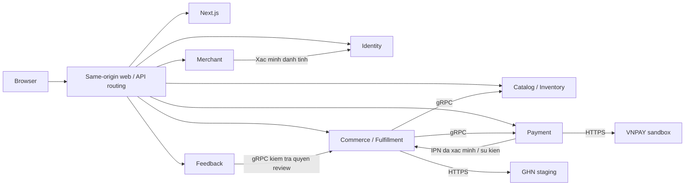

# Agora — Kiến trúc hệ thống v0.2

Ngày: 2026-10-21. Đã bootstrap khung identity-service và datasource/Flyway; nghiệp vụ còn ở mức thiết kế. [ADR-0001](../decisions/0001-foundation.md) ghi nền tảng, [ADR-0002](../decisions/0002-separate-identity-merchant.md) chốt tách Identity/Merchant và database local.

## 1. Đích kiến trúc và phần triển khai đầu tiên

| Ứng dụng | Context | Dữ liệu sở hữu | Bắt đầu |
|---|---|---|---|
| identity-service | Identity/Access | PostgreSQL local agora; schema identity | Đã bootstrap |
| merchant-service | Merchant | PostgreSQL agora_merchant, dự kiến | Sau Identity |
| catalog-service | Catalog/Inventory | PostgreSQL agora_catalog | Sau khi shop hoạt động |
| commerce-service | Commerce, Fulfillment, Notification | PostgreSQL agora_commerce | Sau catalog |
| payment-service | Payment | PostgreSQL agora_payment | Thử sandbox sớm, tích hợp cùng checkout |
| feedback-service | Feedback | MongoDB agora_feedback | Sau đơn giao thành công |

Chạy chung instance PostgreSQL local nhưng dùng database/user riêng. Không join hoặc đọc bảng xuyên service. Context cùng process dùng interface module và giữ quyền sở hữu bảng.

Khởi tạo Identity trước rồi Merchant và web. Đích 6 service không buộc có 6 ứng dụng rỗng ngay. Local tái sử dụng PostgreSQL 16 có sẵn, không thay instance hoặc nâng cấp dữ liệu người dùng.

## 2. Luồng truy cập

Sơ đồ mô tả đích; edge là cấu hình routing, không phải service nghiệp vụ thứ sáu. Local dùng Next.js rewrites với tuyến cho phép; khi deploy mới chọn reverse proxy/TLS cụ thể. Không mở proxy tới URL tùy ý do client cung cấp.

Web gọi HTTP/JSON cùng origin dưới /api/v1. gRPC dành cho backend, không gọi gRPC thông thường trực tiếp từ trình duyệt. Chưa thêm BFF nghiệp vụ: quy tắc vẫn thuộc backend.

## 3. Đăng nhập và phân quyền

- Lát cắt 1 dùng Spring Security, Spring Session JDBC và cookie AGORA_SESSION: HttpOnly, SameSite=Lax, Path=/, Secure trên HTTPS; chỉ profile local HTTP được bỏ Secure.
- Session hết hạn sau 30 phút không hoạt động; đăng nhập đổi session ID; đăng xuất vô hiệu hóa session và xóa cookie. Không lưu session ID/token trong Zustand hoặc localStorage.
- CSRF giữ bật cho thao tác browser thay đổi dữ liệu, kể cả đăng ký/đăng nhập. Web lấy token từ GET /api/v1/auth/csrf và gửi X-CSRF-TOKEN; lấy token mới sau đăng nhập/đăng xuất.
- Mật khẩu dùng Argon2id qua PasswordEncoder; định dạng lưu có định danh encoder, tham số được benchmark khi triển khai. Không tự viết thuật toán.
- USER và ADMIN là vai trò tài khoản. Quyền bán hàng suy ra từ sở hữu shop và trạng thái shop, không nhận role từ form đăng ký.
- API admin/ownership được kiểm tra ở backend. Khóa tài khoản phải làm mất hiệu lực đăng nhập hiện có, không chỉ chặn lần login tiếp theo.
- Khi service thứ hai cần xác thực, thêm hợp đồng gRPC kiểm tra session/CSRF với Identity; service khác không đọc bảng session. Lưu lượng nội bộ cần giới hạn truy cập và TLS khi deploy. Không giả định mạng nội bộ tự đáng tin.
- Cách xác thực tập trung này tăng phụ thuộc khả dụng vào Identity và thêm một lời gọi cho request được bảo vệ; chấp nhận cho portfolio. Identity không truy cập được thì từ chối an toàn, không bỏ kiểm tra.

## 4. Giao tiếp, giao dịch và phục hồi

- gRPC đồng bộ cho lấy báo giá, giữ/phân bổ hàng và yêu cầu hành động cần phản hồi; đặt deadline, không retry mù thao tác có side effect.
- Chọn RabbitMQ cho sự kiện khi bắt đầu tương tác liên service; chưa là dependency chạy của lát cắt mở shop.
- Outbox ghi cùng transaction nguồn; consumer dedup cùng transaction xử lý. Sự kiện có eventId, eventType, schemaVersion, occurredAt, producer, aggregateId, aggregateVersion, correlationId và payload.
- Commerce điều phối checkout, giữ hàng, thanh toán và bù. Không transaction phân tán và không xem timeout như thất bại chắc chắn.
- VNPAY IPN và GHN callback có tuyến riêng, cơ chế xác minh riêng. Không tắt CSRF chung cho API browser để tiếp nhận callback.

## 5. Tích hợp ngoài và vận hành

- Cloudinary: backend kiểm tra quyền upload/gắn/xóa; DB lưu public_id và metadata. Avatar/ảnh sản phẩm bổ sung sau lát cắt 1.
- GHN: một điểm lấy hàng/shop, một kiện/đơn, không COD. Địa chỉ và liên kết ShopId staging phải được xác minh khi tích hợp; sandbox không kiểm chứng vận chuyển lạnh thực tế.
- VNPAY: lưu attempt và tham chiếu độc lập với Order; có tra cứu/refund, xác minh tiền đến muộn và callback lặp.
- Local hiện dùng PostgreSQL native 16, agora cho Identity; Docker/Compose có sẵn nhưng chưa cần thêm Postgres container. MongoDB/RabbitMQ bật khi cần. CI/build tự động làm sau, chưa tự deploy.
- Log có traceId/correlationId, che cookie/password/token provider/chi tiết nhạy cảm. Health check không lộ cấu hình hoặc secret.

## 6. Phạm vi tiếp theo

[Cấu trúc thư mục](project-structure.md), [mô hình dữ liệu](data-model.md), [quy ước API](api-conventions.md), [kế hoạch](../../tasks/plan.md). Schema gRPC/event cụ thể và hạ tầng deploy sẽ theo lát cắt cần dùng.

## Nguồn

- [Spring Boot system requirements](https://docs.spring.io/spring-boot/system-requirements.html)
- [Spring Session JDBC](https://docs.spring.io/spring-session/reference/configuration/jdbc.html)
- [Spring Security CSRF](https://docs.spring.io/spring-security/reference/servlet/exploits/csrf.html)
- [Spring Security password storage](https://docs.spring.io/spring-security/reference/features/authentication/password-storage.html)
- [Next.js rewrites](https://nextjs.org/docs/app/api-reference/config/next-config-js/rewrites)
