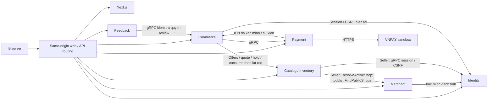

# Agora — Kiến trúc hệ thống v0.4

## Catalog M3b — reservation

Catalog sở hữu reservation và bộ đếm held trên PostgreSQL, dùng listener9093 hiện có cùng token nội bộ. `Hold` giữ toàn bộ SKU của một shop bằng transaction; `Get`/`Release` trả trạng thái hiện tại và giải phóng HELD quá hạn. Không cần service hoặc datastore mới. Merchant ACTIVE được kiểm ngoài transaction cho hold mới; replay/release không phụ thuộc Merchant. Không có snapshot xuyên service.

checkout_id là identity vĩnh viễn, không áp retention7ngày của giỏ. Khóa product rồi lot theo UUID; chọn FEFO trong memory. Cleanup batch hữu hạn, cùng Get/Release bảo vệ TTL15phút. Cart M3a vẫn không giữ tồn, M3c hiện có caller Commerce qua CatalogCheckout.HoldCheckout, đã nghiệm thu local ngày27/10/2026. M3d mới bổ sung HELD → CONSUMED cho thanh toán; chưa có VNPAY. Không thêm ALLOCATED/SHIPPED cho luồng mới. [Chi tiết](../../tasks/slice-3-reservations.md), [bằng chứng theo ngày](../demo-reservations.md).

Lịch sử ngày 26/10/2026: Identity/Merchant/Catalog đã nghiệm thu local qua M2c2; Commerce là service thứ tư đã triển khai giỏ M3a. Root backend 226 tests đạt theo main 10:55:16 +07:00; M3a đã nghiệm thu local ngày 26/10 sau review, live và cleanup. Payment/Feedback, reservation/checkout vẫn là thiết kế. [ADR-0001](../decisions/0001-foundation.md), [ADR-0002](../decisions/0002-separate-identity-merchant.md), [ADR-0003](../decisions/0003-postgresql-only.md) giữ nền tảng/sáu service đích/PostgreSQL-only. [Demo storefront](../demo-storefront.md) giữ proof M2c2; [demo giỏ](../demo-cart.md) ghi proof M3a riêng theo ngày.

## Quyết định phạm vi — 27/10/2026

[ADR-0004](../decisions/0004-order-and-payment-only.md) chốt chỉ đặt hàng/thanh toán, không vận chuyển hoặc nhận tại shop. Không GHN/Fulfillment, địa chỉ giao nhận, kiện, phí hay tracking trong checkout mới. Tổng đơn chỉ gồm tiền hàng. M3c theo [plan checkout](../../tasks/slice-3-checkout.md) đã có implementation preview/accepted hold/attempt/orders, đã nghiệm thu local ngày27/10/2026; M3d mới thêm Payment và PAID. Dữ liệu Merchant/contact/pickup_address, quy cách SKU và cột allocated đã có được giữ nguyên như legacy, không migrate/xóa.

## 1. Đích kiến trúc và phần triển khai đầu tiên

| Ứng dụng | Context | Dữ liệu sở hữu | Bắt đầu |
|---|---|---|---|
| identity-service | Identity/Access | PostgreSQL local agora; schema identity | Đã triển khai M1 |
| merchant-service | Merchant | PostgreSQL agora_merchant; schema merchant | Đã triển khai M1 |
| catalog-service | Catalog/Inventory | PostgreSQL agora_catalog; schema catalog | M2a/M2b1/M2b2/M2c1 đã nghiệm thu local; M2c2 public browse/detail đã triển khai, đã nghiệm thu local ngày 25/10/2026; reservation M3b đã nghiệm thu 27/10 |
| commerce-service | Commerce; Notification là đích | PostgreSQL agora_commerce; schema commerce | Giỏ M3a đã nghiệm thu; checkout/đơn M3c đã có source, đã nghiệm thu local ngày27/10/2026; HTTP8084 |
| payment-service | Payment | PostgreSQL agora_payment | M3d: VNPAY sandbox sau checkout M3c |
| feedback-service | Feedback | PostgreSQL agora_feedback; schema feedback, dự kiến | Xác minh dòng đơn PAID qua Commerce |

Tất cả service dùng PostgreSQL; có thể chạy chung instance local nhưng database thuộc từng service. Local đang dùng role postgres theo yêu cầu, deployment phải có role riêng và quyền tối thiểu. Không join hoặc đọc bảng xuyên service. Context cùng process dùng interface module và giữ quyền sở hữu bảng.

Khởi tạo Identity trước rồi Merchant và web. Đích 6 service không buộc có 6 ứng dụng rỗng ngay. Local tái sử dụng PostgreSQL 16 có sẵn, không thay instance hoặc nâng cấp dữ liệu người dùng.

## 2. Luồng truy cập

Sơ đồ mô tả đích; edge là cấu hình routing, không phải service nghiệp vụ thứ sáu. Local dùng Next.js rewrites với tuyến cho phép; khi deploy mới chọn reverse proxy/TLS cụ thể. Không mở proxy tới URL tùy ý do client cung cấp.

Web gọi HTTP/JSON cùng origin dưới /api/v1. gRPC dành cho backend, không gọi gRPC thông thường trực tiếp từ trình duyệt. Chưa thêm BFF nghiệp vụ: quy tắc vẫn thuộc backend.

## 3. Đăng nhập và phân quyền

- Lát cắt 1 dùng Spring Security, Spring Session JDBC và cookie AGORA_SESSION: HttpOnly, SameSite=Lax, Path=/, Secure trên HTTPS; chỉ profile local HTTP được bỏ Secure.
- Session hết hạn sau 30 phút không hoạt động; đăng nhập đổi session ID; đăng xuất vô hiệu hóa session và xóa cookie. Không lưu session ID/token trong Zustand hoặc localStorage.
- CSRF giữ bật cho thao tác browser thay đổi dữ liệu, kể cả đăng ký/đăng nhập. Web lấy token từ GET /api/v1/auth/csrf và gửi X-CSRF-TOKEN; lấy token mới sau đăng nhập/đăng xuất.
- Mật khẩu dùng Argon2id qua PasswordEncoder; định dạng lưu có định danh encoder, tham số được benchmark khi triển khai. Không tự viết thuật toán.
- USER và ADMIN là vai trò tài khoản. Quyền bán hàng suy ra từ sở hữu shop và trạng thái shop, không nhận role từ form đăng ký.
- API admin/ownership được kiểm tra ở backend. Khóa tài khoản phải làm mất hiệu lực đăng nhập hiện có, không chỉ chặn lần login tiếp theo.
- Merchant đã dùng hợp đồng gRPC kiểm tra session/CSRF với Identity; service khác không đọc bảng session. Lưu lượng nội bộ cần giới hạn truy cập và TLS khi deploy. Không giả định mạng nội bộ tự đáng tin.
- Cách xác thực tập trung này tăng phụ thuộc khả dụng vào Identity và thêm một lời gọi cho request được bảo vệ; chấp nhận cho portfolio. Identity không truy cập được thì từ chối an toàn, không bỏ kiểm tra.

## 4. Giao tiếp, giao dịch và phục hồi

- gRPC đồng bộ cho xác minh giá, giữ/tiêu thụ tồn và yêu cầu hành động cần phản hồi; đặt deadline, không retry mù thao tác có side effect.
- Chọn RabbitMQ cho sự kiện khi bắt đầu tương tác liên service; chưa là dependency chạy của lát cắt mở shop.
- Outbox ghi cùng transaction nguồn; consumer dedup cùng transaction xử lý. Sự kiện có eventId, eventType, schemaVersion, occurredAt, producer, aggregateId, aggregateVersion, correlationId và payload.
- Commerce điều phối checkout, giữ hàng, thanh toán và bù. Không transaction phân tán và không xem timeout như thất bại chắc chắn.
- VNPAY IPN có tuyến và cơ chế xác minh riêng. Không tắt CSRF chung cho API browser để tiếp nhận callback.

## 5. Tích hợp ngoài và vận hành

- Cloudinary: Catalog proxy upload ảnh DRAFT/HIDDEN, xác minh metadata và lưu intent/relation riêng; gắn/gỡ tăng version product, cleanup chỉ xóa upload không còn tham chiếu. PUBLISHED cần ẩn trước sửa/đổi ảnh. BasicAuth chỉ dùng phía backend với host HTTPS cố định. Avatar bổ sung ở lát cắt Identity sau.
- VNPAY (M3d, chưa triển khai): lưu attempt/tham chiếu độc lập với Order, xác minh IPN và tra cứu/refund cho tiền muộn/trùng; Return URL không xác nhận thanh toán.
- Order đích AWAITING_PAYMENT → PAID hoặc EXPIRED/CANCELLED. PAID là terminal khi tiền hợp lệ và Catalog xác nhận HELD → CONSUMED, giảm held/on_hand cùng transaction, chống lặp. Timeout cần đối chiếu, không hủy mù khoản thu chưa rõ. Refund tài chính không tự tăng tồn hoặc đổi PAID thành trạng thái giao nhận. Review dựa trên dòng đơn PAID; claim chất lượng sau giao ngoài phạm vi.
- Local dùng PostgreSQL native 16: agora cho Identity, agora_merchant cho Merchant và agora_catalog cho Catalog. Commerce cấu hình agora_commerce/schema commerce và HTTP 8084; fixture M3a dùng database test riêng, chưa xác nhận tạo/migrate Commerce trên native. Database Payment/Feedback chỉ tạo khi triển khai. Không cần MongoDB; RabbitMQ bổ sung khi có luồng sự kiện cần dùng. Integration tests dùng PostgreSQL Docker biệt lập. Đã có workflow CI riêng hai repo; chưa xác nhận GitHub run hoặc deploy.
- Log có traceId/correlationId, che cookie/password/token provider/chi tiết nhạy cảm. Health check không lộ cấu hình hoặc secret.

## 6. Phạm vi tiếp theo

[Cấu trúc thư mục](project-structure.md), [mô hình dữ liệu](data-model.md), [quy ước API](api-conventions.md), [kế hoạch](../../tasks/plan.md). Schema gRPC/event cụ thể và hạ tầng deploy sẽ theo lát cắt cần dùng.

## Nguồn

- [Spring Boot system requirements](https://docs.spring.io/spring-boot/system-requirements.html)
- [Spring Session JDBC](https://docs.spring.io/spring-session/reference/configuration/jdbc.html)
- [Spring Security CSRF](https://docs.spring.io/spring-security/reference/servlet/exploits/csrf.html)
- [Spring Security password storage](https://docs.spring.io/spring-security/reference/features/authentication/password-storage.html)
- [Next.js rewrites](https://nextjs.org/docs/app/api-reference/config/next-config-js/rewrites)

## M2c1 — Inventory trong Catalog

M2c1 quản lý lô hàng đã nghiệm thu local ngày24/10/2026 sau resume20:23: backend150 tests (16:03:17, source không đổi), frontend98 unit,177 browser fixture production và5 live qua ba service đều đạt; build/lint/typecheck đạt, review cuối không còn blocker trong phạm vi sửa. Các số này là proof M2c1; chưa có reservation/FEFO allocation hoặc checkout.

InventoryLot dùng cùng database Catalog, không thêm service hoặc broker. Tạo lô và replace Product khóa cùng product row trước kiểm SKU; FK cùng product/shop/SKU và upsert giữ lịch sử. Lô có version riêng; lot/audit/idempotency result commit cùng transaction. Trạng thái hết hạn được tính theo ngày Việt Nam trên request, không dựa scheduler. Claim/replay xảy ra trước kiểm tra thời gian hiện tại; replay là snapshot lịch sử, GET mới quyết định trạng thái hiển thị. Xem [data model](data-model.md), [quyền](catalog-security.md) và [demo](../demo-inventory.md).

## M2c2 — public browse/detail, đã nghiệm thu local

Đã triển khai hai GET `/api/v1/products` và `/api/v1/products/{productId}` trong Catalog, không gọi Identity cho public read. Chỉ PUBLISHED có attached UPLOADED photo và shop hiện ACTIVE qua Merchant `FindPublicShops`. Merchant chỉ trả `{id,name}`, tên tối đa120codepoints, omit legacy blank. Catalog dùng projection riêng, không trả private Product/Shop/lot/upload; [allowlist và trường private](catalog-security.md#storefront-m2c2--public-projection).

Browse đọc21candidate theo created_at DESC,id DESC, chỉ xét20và gọi Merchant tối đa4batch×5ID. Candidate thứ21 chỉ lookahead; cursor advance theo candidate cuối đã xét. Sau lọc shop có thể có trang rỗng nhưng còn `nextCursor`. Không total count, không tải toàn bộ shop; RPC deadline2giây/call, không retry, lỗi bất kỳ batch nào trả503 toàn request. Detail dùng snapshot REPEATABLE_READ cục bộ, kết thúc transaction trước RPC; shop/product có thể đổi sau kiểm tra, GET sau phải đọc lại.

Product/SKU `inStock` chỉ là boolean từ lô ACTIVE còn hạn theo ngày Việt Nam và on_hand-held-allocated>0; hết tồn vẫn xem được. Tại nghiệm thu M2c2 ngày25/10 chưa có reservation/checkout/VNPAY/review/Q&A hoặc profile shop đầy đủ; snapshot public không phải cam kết mua. M3b reservation đã nghiệm thu27/10; GHN không còn trong target theo ADR-0004. [Demo storefront](../demo-storefront.md) ghi proof backend25/10; frontend/live/review đã hoàn tất, bằng chứng cuối ghi trong demo storefront.

## M3a — giỏ hàng trong Commerce

Giỏ đăng nhập nhiều shop, tối đa 20 SKU/1–99 gói mỗi dòng; không giữ stock hoặc tạo Order. Commerce sở hữu cart/version/request, Catalog sở hữu product/SKU/giá/tồn, Merchant xác minh shop ACTIVE. [Ba HTTP operation](../../contracts/openapi/commerce-cart.v1.openapi.json) ở 8084; [CatalogOffers v1](../../contracts/proto/agora/catalog/v1/catalog_offers.proto) ở listener optional 127.0.0.1:9093.

GET đọc cart trong REPEATABLE_READ ngắn, đóng transaction rồi RPC current offers. Catalog đọc một SQL snapshot rồi Merchant tối đa 4 batch × 5shop. Offer thiếu thành null; dependency/malformed response làm GET503 toàn request. Không snapshot phân tán, request sau phải kiểm lại. Giỏ không lưu giá/tên/ảnh cũ.

Mọi HTTP request kiểm Identity hiện tại; mutation kiểm CSRF/cartId theo account trước replay/write. PUT preflight replay trước Catalog, gọi Catalog ngoài transaction rồi recheck replay dưới cart row lock. Lookup lỗi/không khả dụng cũng tra lại replay để bắt original commit đồng thời. Item/version/request result commit cùng transaction; key giữ tối thiểu 7 ngày. DELETE không gọi Catalog, vẫn cần Identity/CSRF/version đúng. Sau mutation cần GET mới; refresh 503 chỉ giữ refs tối thiểu để xóa. [API](api-conventions.md#7-commerce-m3a), [demo/proof](../demo-cart.md).

Reservation FEFO thuộc Catalog ở M3b, checkout một shop thuộc Commerce ở M3c, Payment/VNPAY ở M3d theo plan. M3a không đổi on_hand/held/allocated hoặc gọi GHN/VNPAY.

## M3c — preview, admission và recovery hiện có

[HTTP contract](../../contracts/openapi/commerce-checkout.v1.openapi.json), [proto](../../contracts/proto/agora/catalog/v1/catalog_checkout.proto), [plan](../../tasks/slice-3-checkout.md), [demo/evidence](../demo-checkout.md). Commerce lưu preview5phút theo exact Catalog DB expiry, giữ product versions nội bộ; HTTP không lộ version/lot. Quote chỉ kiểm public/ảnh/shop ACTIVE/inStock, chưa bảo đảm đủ exact quantity. HoldCheckout kiểm accepted price/version và cấp đủ FEFO trong cùng transaction.

Catalog V7 giữ permanent closed decision dưới cùng advisory checkout identity lock với raw Hold. Replay reservation/closed trước admission mới, kiểm owner/hash; business rejection rollback savepoint toàn partial stock/audit nhưng giữ identity lock rồi commit typed closure. SQL/timeout không tạo closure giả. Quote/admission và accepted reservation dùng Catalog DB clock; raw M3b giữ semantics cũ.

Commerce V2 commit attempt trước RPC, acquire lease30giây/revision rồi gọi Catalog ngoài transaction. Recovery10giây/batch20 dùng cùng HoldCheckout payload kể cả sau preview deadline; không suy FAILED từ Get NOT_FOUND và đồng hồ Commerce. Typed closed hoặc validated RELEASED mới chốt thất bại; unknown giữ PROCESSING. Local completion kiểm lease/revision, commit Order+attempt+cart cùng transaction; chỉ dọn selected lines khi cart version còn khớp. Order là snapshotJSONB, expiry tính lúc đọc; worker hiện recover attempt, không có worker riêng cập nhật state order. M3c đã nghiệm thu local ngày27/10/2026: root303PASS, Catalog PauliCLEAR/Commerce BanachCLEAR và real4app+Cloudinary/live cleanup đã được main độc lập xác minh; [exact evidence](../demo-checkout.md).
