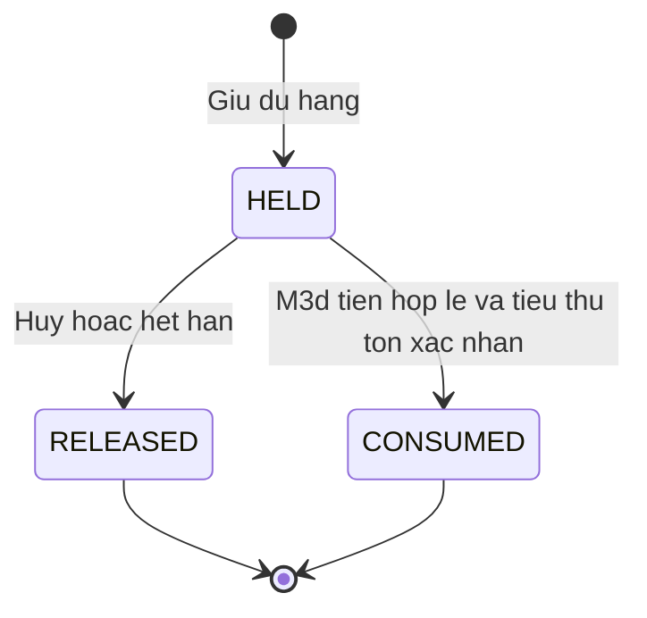
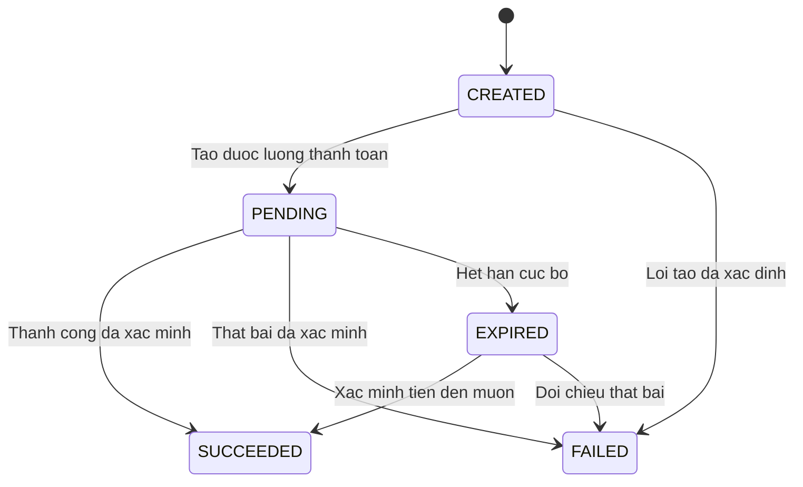
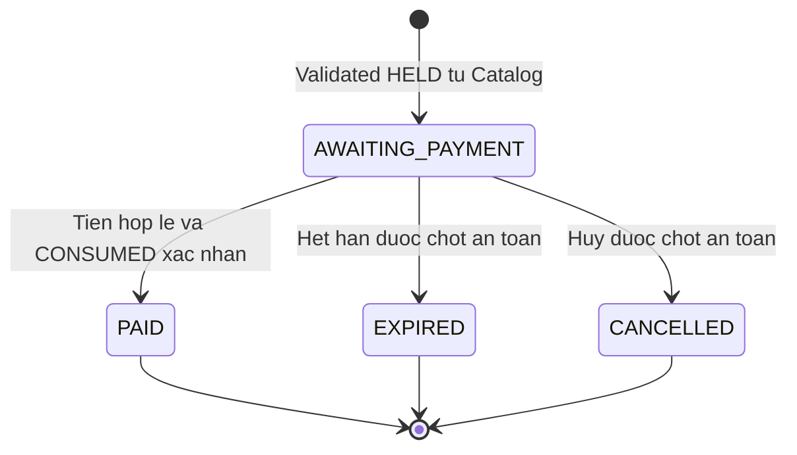
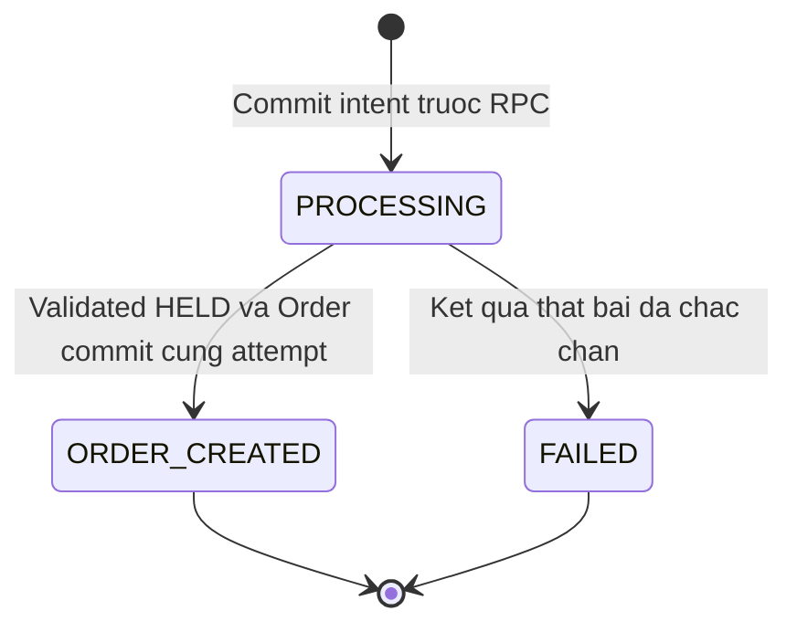
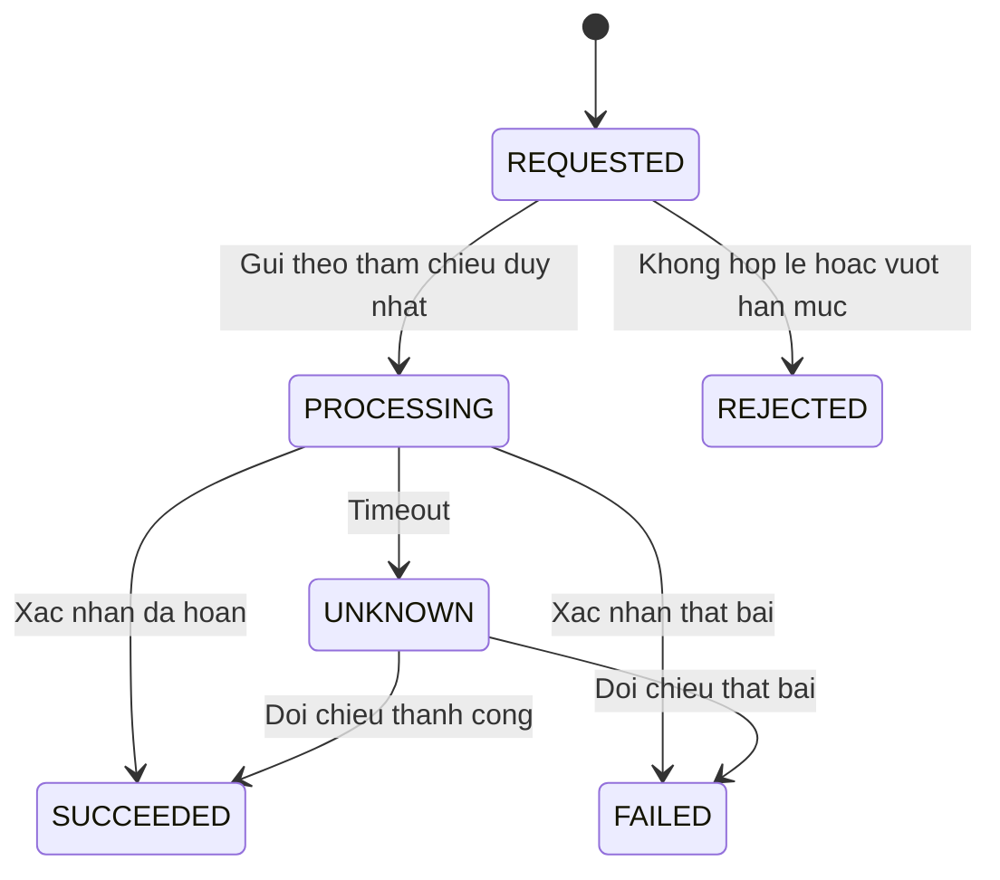

# Agora — Trạng thái nghiệp vụ MVP v0.1

## Trạng thái implementation M3b ngày27/10/2026

Reservation hiện thực HELD → RELEASED với CANCELLED hoặc EXPIRED; TTL15phút kiểm bằng Clock server sau khóa, không chỉ dựa worker30giây/batch20. Replay trả trạng thái hiện tại, không gia hạn/hồi sinh. Hold tăng held; release giảm held; không đổi on_hand/allocated. M3d sẽ thêm HELD → CONSUMED; ALLOCATED/SHIPPED không còn là mô hình đích. Product bị ẩn hoặc lot BLOCKED không ngăn release. [Plan](../../tasks/slice-3-reservations.md), [guide/proof](../demo-reservations.md).

Phạm vi đích ngày 27/10/2026 theo [ADR-0004](../decisions/0004-order-and-payment-only.md): chỉ đặt hàng/thanh toán, không vận chuyển hoặc nhận tại shop. Sáu service giữ nguyên; Merchant/contact/pickup_address/quy cách SKU/cột allocated legacy không bị xóa hoặc migrate. [M3c checkout](../../tasks/slice-3-checkout.md) có implementation đã nghiệm thu local ngày27/10/2026; [demo/evidence](../demo-checkout.md); M3d mới có PAID/CONSUMED/Payment.

Trạng thái: bản nháp cùng [use case](use-cases.md) và [bản đồ context](capability-map.md). Tên dưới đây là enum nội bộ đề xuất, không phải mã chính thức của VNPAY.

## 1. Nguyên tắc

- Tách Order, CheckoutAttempt, PaymentAttempt, Reservation và Refund; không ghép thành một enum.
- Mỗi context dùng transaction cục bộ; xuyên service có trạng thái trung gian/retry/bù/đối chiếu.
- Chuyển trạng thái kiểm tra quyền, điều kiện, chống trùng và version khi cạnh tranh; lưu audit/correlation ID.
- Lưu raw provider status và kết quả xác minh. Thời điểm callback tới không tự chứng minh thứ tự nghiệp vụ.
- Kết quả chưa rõ không được retry mù thao tác tạo đơn/thu tiền/hoàn tiền.

## 2. Shop, sản phẩm, lô

| Đối tượng | Trạng thái | Quy tắc |
|---|---|---|
| Shop | `DRAFT`, `PENDING_REVIEW`, `ACTIVE`, `REJECTED`, `SUSPENDED` | Duyệt/từ chối có lý do; đình chỉ chặn giao dịch mới |
| Product | `DRAFT`, `PUBLISHED`, `HIDDEN`, `BLOCKED` | Công bố cần shop hoạt động/dữ liệu hợp lệ; chủ shop ẩn, admin khóa |
| InventoryLot | `ACTIVE`, `BLOCKED`, `EXPIRED`, `DEPLETED` | Chỉ lô đủ điều kiện được giữ; hết hạn/khóa/hết tồn chặn giữ/consume mới |

Implementation hiện tại: Product có DRAFT/PUBLISHED/HIDDEN; Product BLOCKED và quản trị khóa sản phẩm trong bảng là đích. Inventory M2c1 lưu ACTIVE/BLOCKED, tính EXPIRED/DEPLETED trên request. Reservation HELD/RELEASED đã nghiệm thu M3b; checkout M3c hiện có và đã nghiệm thu local ngày27/10/2026; CONSUMED/Payment bên dưới là đích chưa triển khai.

Public browse/detail M2c2 đã triển khai, đã nghiệm thu local ngày 25/10/2026: chỉ PUBLISHED+attached UPLOADED photo+shop hiện ACTIVE. Product/SKU `inStock` là boolean có lô ACTIVE, expires_on>hôm nay Asia/Ho_Chi_Minh, on_hand-held-allocated>0; thiếu tồn chỉ false, không ẩn sản phẩm. Boolean không tạo HELD hoặc đảm bảo mua. Khóa account owner không tự chuyển shop sang SUSPENDED; public kiểm shop hiện tại, checkout sau này cần policy riêng. [Demo và proof backend](../demo-storefront.md); frontend/live/review đã đạt, xem bằng chứng cuối trong demo storefront.

Trạng thái lô không thay phép tính tồn và kiểm tra thời gian hiện tại. Scheduler cập nhật EXPIRED chậm không được khiến checkout bán hàng hết hạn. Mở khóa không được làm lô hết hạn thành đủ điều kiện.

## Giỏ hàng M3a — đã triển khai, chưa giữ hàng

Cart lưu account/version/items trong Commerce, không có HELD/ALLOCATED/Order. Thêm/đổi quantity tuyệt đối1–99 hoặc xóa dòng thực sự thay đổi tăng version một lần; PUT quantity không đổi/DELETE dòng đã thiếu là no-op với version đúng. Tổng tối đa 20 SKU, nhiều shop. GET chưa có row trả version 0 không tạo DB row; giỏ đã xóa hết vẫn giữ version.

Auth/CSRF/cartId theo account kiểm trước replay/write; version bảo vệ ý định khác nhau, UUID key/hash7 ngày bảo vệ cùng ý định. PUT preflight replay trước Catalog rồi recheck dưới row lock; DELETE không cần Catalog. Replay trả version lịch sử, không tăng version lần hai; GET mới cho current offers. Mất public giữ offer:null, không tự xóa dòng hoặc tạo reservation. [API](../architecture/api-conventions.md#7-commerce-m3a), [demo/proof](../demo-cart.md). Lịch sử M3a ngày 26/10: root backend226tests đạt theo main10:55:16+07:00; frontend/live/review đã hoàn tất, xem demo giỏ.

## 3. Reservation — hiện có M3b và đích M3d



CONSUMED là thiết kế M3d, không nằm trong RPC/schema M3b đã nghiệm thu. M3c thêm kiểm giá/version nguyên tử cùng Hold, không thêm trạng thái trả tiền.

```text
available = on_hand - held - allocated
on_hand >= 0; held >= 0; allocated >= 0; available >= 0
```

Cột allocated/phép tính hiện có giữ để tương thích schema/lịch sử; allocated bằng 0 trong dữ liệu test M3b. Không thêm ALLOCATED hoặc SHIPPED giả cho luồng mới.

| Thao tác | Thay đổi nguyên tử |
|---|---|
| Tạo HELD (M3b) | Tăng held nếu đủ available; không đổi on_hand/allocated |
| HELD → RELEASED (M3b) | Giảm held một lần, không đổi on_hand/allocated |
| HELD → CONSUMED (đích M3d) | Giảm held và on_hand đúng lượng trong cùng transaction với state/audit/dedup; không đổi allocated |

- Checkout identity vĩnh viễn, buyer binding và quantity/SKU/lot bất biến. Replay trả trạng thái hiện tại, không gia hạn hoặc thay bộ đếm lần hai.
- RELEASED/CONSUMED terminal; hết hạn chỉ giải phóng HELD. Tiền muộn không hồi sinh reservation, cần đối chiếu/refund.
- Consume và expiry/release cạnh tranh qua transaction/khóa/version Catalog; lô BLOCKED/hết điều kiện không được consume mới. Release vẫn được phép.
- Consume timeout phải tra trạng thái theo cùng identity trước quyết định PAID/refund; không suy ra chưa trừ tồn. Refund không đảo CONSUMED hoặc tự tăng tồn.

## 4. PaymentAttempt



- Một order nhiều attempt, mỗi attempt tham chiếu cổng duy nhất. Không tạo attempt mới khi attempt cũ chưa rõ mà chưa đối chiếu đủ.
- EXPIRED là hết chờ tại ứng dụng, không chứng minh cổng chưa thu tiền.
- SUCCEEDED không thành FAILED theo callback cũ/Return URL; refund là mô hình riêng.
- Kết quả mâu thuẫn trạng thái đã xác minh được gắn `needs_reconciliation`, lưu bằng chứng và tra lại; không làm mất bằng chứng tiền vì enum terminal.
- Một provider transaction ghi tiền một lần; chỉ một khoản áp vào đơn, khoản thừa hoàn riêng.
- Ghi nhận tiền độc lập quyết định áp tiền vào đơn; đơn hủy vẫn có thể có tiền đã thu và chờ hoàn.

## 5. Order — đích chỉ đặt hàng/thanh toán



M3c chỉ AWAITING_PAYMENT/EXPIRED; M3d mới có PAID, CANCELLED và phối hợp tiền/consume. PAID là terminal của luồng mua; không DELIVERED/COMPLETED, Fulfillment/Shipment, pickup hoặc QualityClaim sau giao. Refund tài chính vẫn có trạng thái riêng.

| Tình huống | Cách xử lý đích |
|---|---|
| Tiền hợp lệ, đơn/HELD đủ điều kiện | Consume nguyên tử trong Catalog, xác nhận kết quả rồi Order PAID |
| Payment SUCCEEDED, consume/commit chưa rõ | Giữ đang xử lý/đối chiếu; không tuyên bố PAID hoặc tự hủy/refund khi chưa biết tồn đã consume |
| Tiền tới đơn EXPIRED/CANCELLED hoặc hold RELEASED | Ghi tiền và nghĩa vụ refund, không hồi sinh Order/hold |
| Nhiều attempt thành công | Chỉ một khoản áp vào đơn; khoản thừa refund riêng |
| Refund chờ sau PAID | PAID giữ terminal, nghĩa vụ tiền theo Refund; không tự tăng tồn |

M3c hiện tính Order EXPIRED từ reservation.expiresAt bằng Commerce DB clock khi đọc; worker Commerce chỉ recover attempt, không ghi state order riêng. M3d phải bổ sung coordination: worker không hủy mù theo đồng hồ khi kết quả tiền/consume chưa rõ. Giữ audit, version/fencing, retry/đối chiếu và bù bền vững qua transaction cục bộ; không transaction phân tán.

## 6. CheckoutAttempt — implementation M3c, đã nghiệm thu local ngày27/10/2026



Preview 5 phút, dùng một lần; lease 30 giây có revision fencing. Timeout/dependency chưa rõ giữ PROCESSING và recover bằng exact key/checkout identity. Reconcile bằng cùng HoldCheckout payload, kể cả sau notAfter; Catalog DB time và permanent decision dưới identity lock đóng admission mới, replay reservation/closed trước. Không dùng Get NOT_FOUND hoặc đồng hồ Commerce để suy FAILED. Validated HELD từ Catalog tạo Order bất kể Commerce clock; FAILED chỉ từ typed closed/validated RELEASED. Không tạo FAILED giả hoặc đơn khi chưa xác nhận giữ tồn. Cart chỉ dọn nếu version vẫn bằng preview, cùng commit Order/attempt.

## 7. Hủy và dữ liệu legacy

Chỉ Order AWAITING_PAYMENT có thể chuyển CANCELLED khi đã đối chiếu an toàn với Payment/Reservation; không thêm luồng xác minh vận đơn. Release HELD một lần và theo dõi nghĩa vụ tiền riêng. API hủy chưa thuộc M3c.

## 8. Phạm vi đã loại bỏ

Theo ADR-0004, sơ đồ Shipment/Cancellation theo bàn giao và QualityClaim sau giao cũ bị loại khỏi target từ 27/10/2026. Không thay bằng nhận tại shop, không có mốc nhận hàng để mở quyền review. Feedback tương lai xác minh buyer sở hữu dòng đơn PAID qua Commerce. Hồ sơ Merchant và metadata SKU cũ giữ nguyên; tài liệu proof cũ vẫn là lịch sử theo ngày.

## 9. Refund



- Refund gắn giao dịch đã thu cụ thể; giữ hạn mức bằng transaction cục bộ trước gửi provider.
- Với mỗi giao dịch: `succeeded_refunds + reserved_for_pending_refunds <= captured_amount`. Tiền thu thừa không là doanh thu shop.
- Không gửi UNKNOWN như yêu cầu mới. FAILED chỉ thử lại có kiểm soát sau xác nhận lần cũ không còn có thể chi tiền; giữ lịch sử attempt.
- Refund chỉ xử lý tiền thu, không cước hoặc điều kiện giao nhận; không tự tăng tồn hoặc thay trạng thái terminal PAID.
- Phải kiểm tra quyền/khả năng hoàn và tra cứu với tài khoản VNPAY sandbox được cấp. Fixture không được mô tả như giao dịch sandbox đã thực hiện.

## 10. Sự kiện và khôi phục

| Nguồn | Sự kiện minh họa | Bên xử lý | Bảo vệ |
|---|---|---|---|
| Payment | `PaymentSucceeded` | Commerce | Áp một khoản; xác nhận consume hoặc refund sau đối chiếu |
| Inventory | `ReservationReleased`, `LotBlocked` | Commerce | Đối chiếu đơn đang giữ/đã trả; chặn lô khóa |
| Inventory | `ReservationConsumed` (đích M3d) | Commerce | Đối chiếu trừ held/on_hand một lần trước PAID |
| Commerce | `RefundRequested` | Payment | Chống trùng và giữ hạn mức |
| Payment | `RefundSucceeded` | Commerce | Nghĩa vụ tiền/đối soát |
| Các module | Kết quả cần thông báo | Notification | Chống trùng theo event/người nhận/loại |

Tên sự kiện chỉ minh họa, schema/version ở bước hợp đồng module. Lưu outbox cùng transaction nguồn; consumer lưu dedup cùng thay đổi cục bộ. Có retry/backoff, nơi giữ sự kiện cần can thiệp và đối chiếu theo tham chiếu.

Giữ hàng 15 phút là thời hạn hiện có M3b; không cửa sổ claim sau giao. Dùng thời gian server; kiểm tra điều kiện trong transaction chuyển trạng thái, không chỉ dựa scheduler đã chạy.

## 11. Tiêu chí kiểm chứng

1. Mỗi cạnh có actor/event, điều kiện và tác dụng phụ; các cạnh rút gọn cần bằng chứng đối chiếu.
2. Tái hiện được cạnh tranh hết hạn/IPN/consume, hủy/consume và refund đồng thời.
3. Tiền nhận không mất vì Order hủy; tồn đã CONSUMED không tự tăng lại vì refund.
4. UI thể hiện chưa rõ/đang đối chiếu và phân biệt provider thật/fixture.
5. Kiểm tra callback trùng/sai thứ tự, phục hồi sau commit trước phát sự kiện.

### Catalog admission M3c hiện có

Quote không tạo reservation. HoldCheckout trả typed reservation HELD/RELEASED hoặc closed reason OFFER_UNAVAILABLE/CHECKOUT_EXPIRED. Closed decision bền vững trong V7, terminal cho checkout identity kể cả khi giá/tồn/shop trở lại hợp lệ. Business rejection rollback partial rows/counters/audit qua savepoint nhưng giữ identity lock rồi commit closure; SQL/timeout rollback không tạo FAILED giả. Accepted hold dùng DB time, raw M3b giữ Clock/hash semantics cũ. Commerce PROCESSING giữ nguyên khi RPC unknown; completion kiểm lease/revision và validated HELD từ Catalog, không quyết định admission bằng đồng hồ Commerce, commit Order+attempt+cart cùng transaction. [Proto](../../contracts/proto/agora/catalog/v1/catalog_checkout.proto), [HTTP contract](../../contracts/openapi/commerce-checkout.v1.openapi.json), [demo/evidence](../demo-checkout.md).
