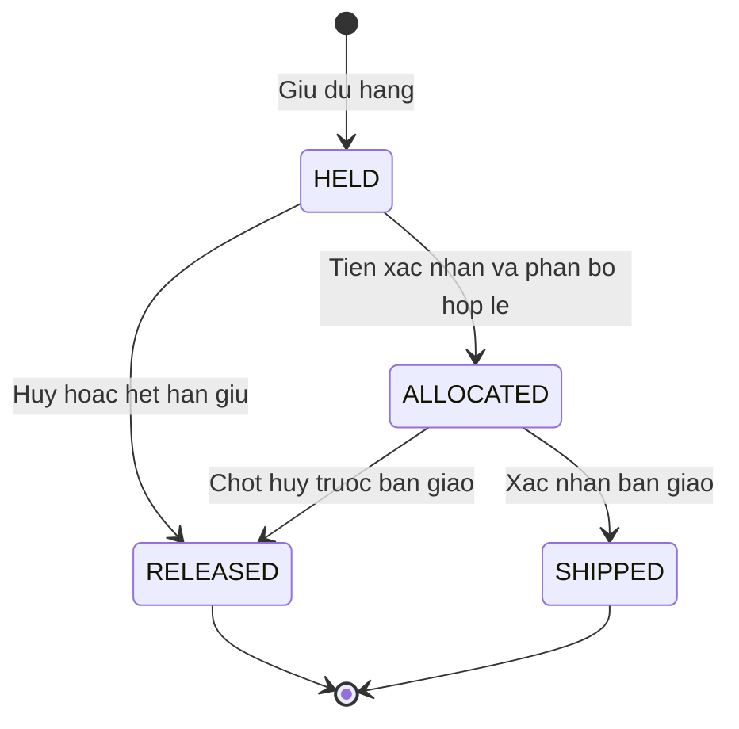
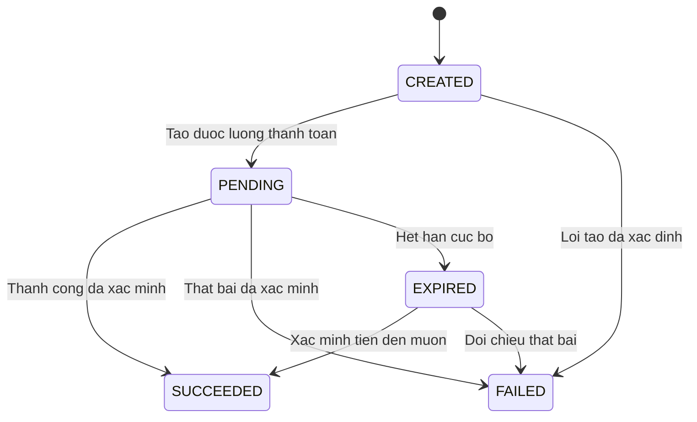
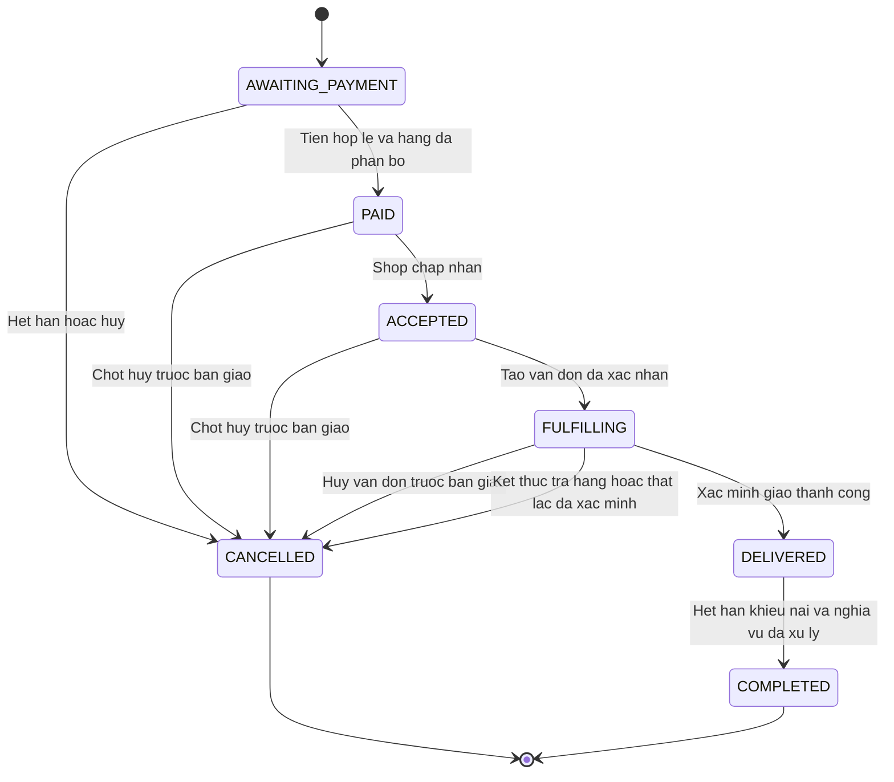
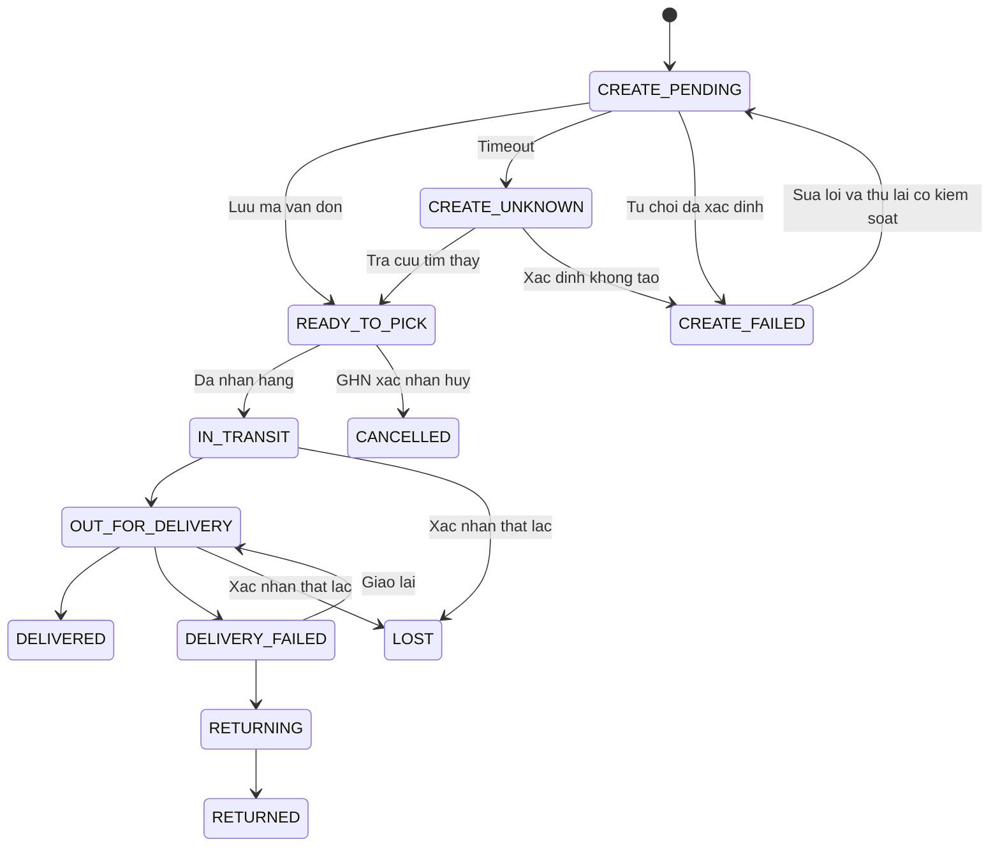
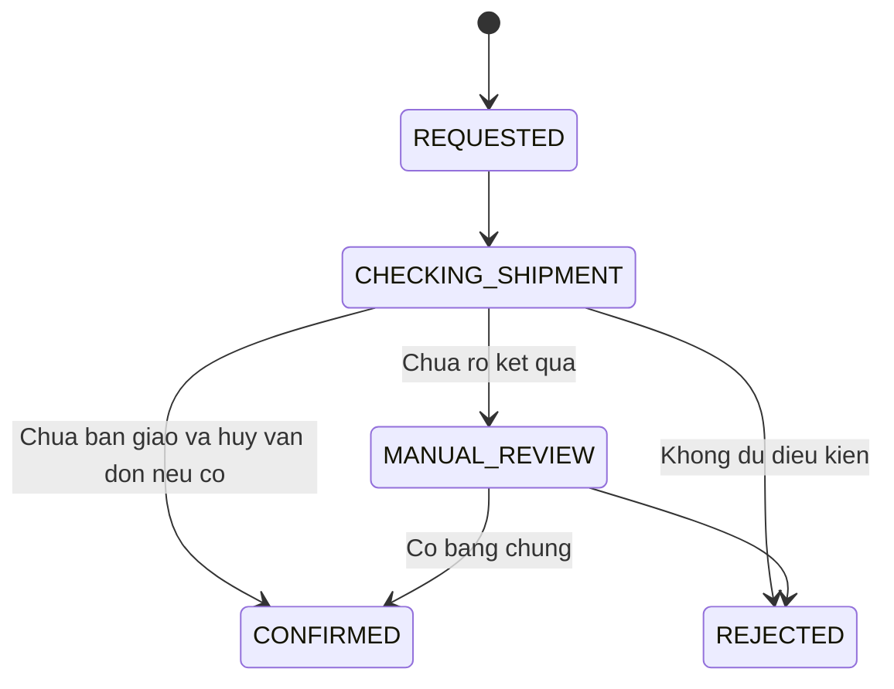
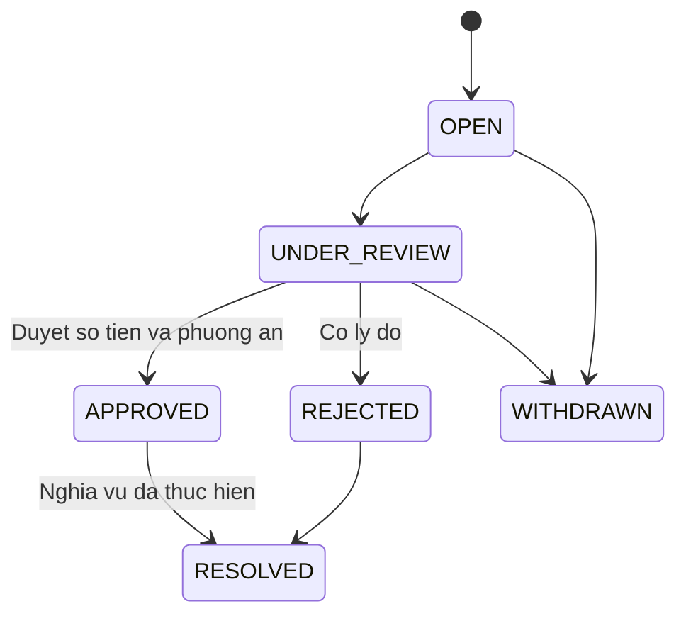
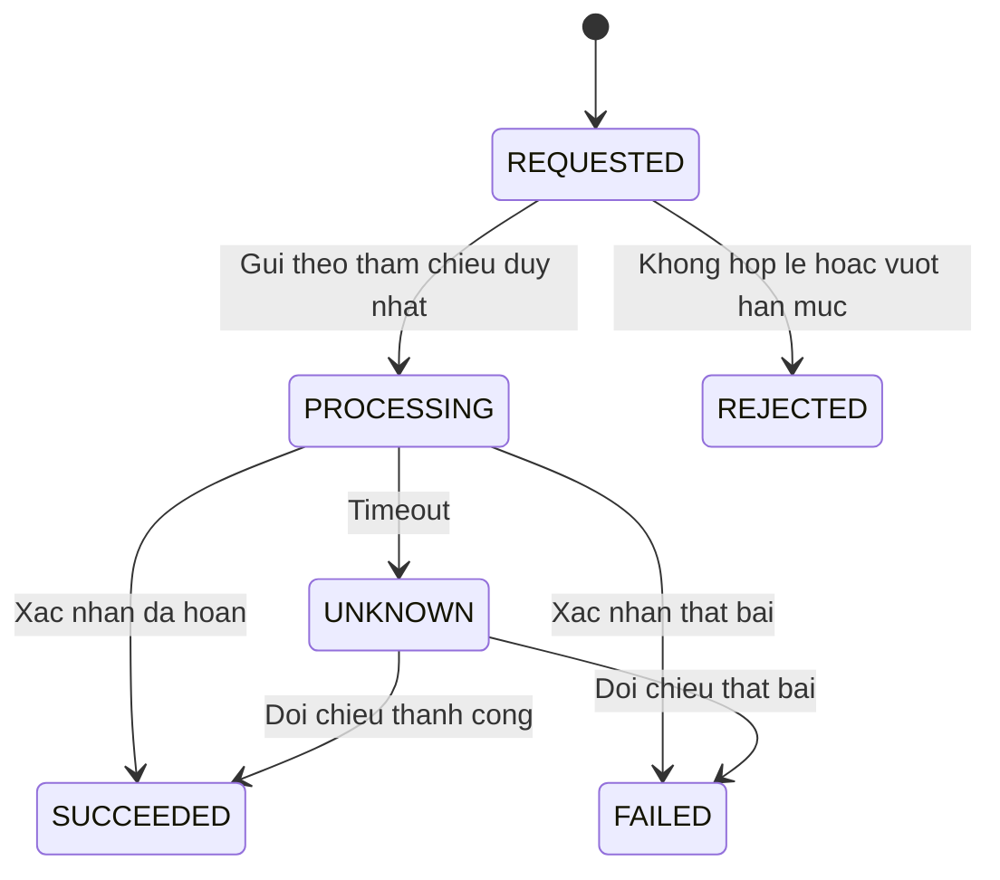

# Agora — Trạng thái nghiệp vụ MVP v0.1

Trạng thái: bản nháp cùng [use case](use-cases.md) và [bản đồ context](capability-map.md). Tên dưới đây là enum nội bộ đề xuất, không phải mã chính thức của VNPAY/GHN.

## 1. Nguyên tắc

- Tách Order, PaymentAttempt, Reservation, Shipment, Cancellation, QualityClaim và Refund; không ghép thành một enum.
- Mỗi context dùng transaction cục bộ; xuyên service có trạng thái trung gian/retry/bù/đối chiếu.
- Chuyển trạng thái kiểm tra quyền, điều kiện, chống trùng và version khi cạnh tranh; lưu audit/correlation ID.
- Lưu raw provider status và kết quả xác minh. Thời điểm callback tới không tự chứng minh thứ tự nghiệp vụ.
- Kết quả chưa rõ không được retry mù thao tác tạo đơn/thu tiền/hoàn tiền.

## 2. Shop, sản phẩm, lô

| Đối tượng | Trạng thái | Quy tắc |
|---|---|---|
| Shop | `DRAFT`, `PENDING_REVIEW`, `ACTIVE`, `REJECTED`, `SUSPENDED` | Duyệt/từ chối có lý do; đình chỉ chặn giao dịch mới |
| Product | `DRAFT`, `PUBLISHED`, `HIDDEN`, `BLOCKED` | Công bố cần shop hoạt động/dữ liệu hợp lệ; chủ shop ẩn, admin khóa |
| InventoryLot | `ACTIVE`, `BLOCKED`, `EXPIRED`, `DEPLETED` | Chỉ lô đủ điều kiện được giữ; hết hạn/khóa/hết tồn chặn phân bổ mới |

Implementation hiện tại: Product có DRAFT/PUBLISHED/HIDDEN; Product BLOCKED và quản trị khóa sản phẩm trong bảng là đích. Inventory M2c1 lưu ACTIVE/BLOCKED, tính EXPIRED/DEPLETED trên request. Reservation/FEFO allocation và checkout bên dưới chưa triển khai.

Public browse/detail M2c2 đã triển khai, đã nghiệm thu local ngày 25/10/2026: chỉ PUBLISHED+attached UPLOADED photo+shop hiện ACTIVE. Product/SKU `inStock` là boolean có lô ACTIVE, expires_on>hôm nay Asia/Ho_Chi_Minh, on_hand-held-allocated>0; thiếu tồn chỉ false, không ẩn sản phẩm. Boolean không tạo HELD/ALLOCATED hoặc đảm bảo mua/giao. Khóa account owner không tự chuyển shop sang SUSPENDED; public kiểm shop hiện tại, checkout sau này cần policy riêng. [Demo và proof backend](../demo-storefront.md); frontend/live/review đã đạt, xem bằng chứng cuối trong demo storefront.

Trạng thái lô không thay phép tính tồn và kiểm tra thời gian hiện tại. Scheduler cập nhật EXPIRED chậm không được khiến checkout bán hàng hết hạn. Mở khóa không được làm lô hết hạn thành đủ điều kiện.

## 3. Reservation



Quy ước theo lô:

```text
available = on_hand - held - allocated
on_hand >= 0; held >= 0; allocated >= 0; available >= 0
```

| Thao tác | Thay đổi nguyên tử |
|---|---|
| Tạo HELD | Tăng held nếu đủ available; không giảm on_hand |
| HELD thành ALLOCATED | Giảm held, tăng allocated; không đổi on_hand |
| Giải phóng HELD/ALLOCATED | Giảm đúng bộ đếm tương ứng; không tăng on_hand |
| ALLOCATED thành SHIPPED | Giảm allocated và on_hand cùng số lượng |

- Reservation lưu order, SKU/lô/số lượng, thời hạn; retry không đổi số lượng lần hai.
- Hết hạn chỉ tự giải phóng HELD, không ALLOCATED của đơn đã trả tiền.
- RELEASED không hồi sinh theo IPN muộn; xử lý tiền bằng refund khi không thể tiếp tục.
- Lô bị khóa/hết điều kiện trước xuất phải xử lý ngoại lệ; không tự xuất.
- Hàng hoàn/giao thất bại không tự đảo SHIPPED; nhập lại cần kiểm định và giao dịch kho riêng.

## 4. PaymentAttempt



- Một order nhiều attempt, mỗi attempt tham chiếu cổng duy nhất. Không tạo attempt mới khi attempt cũ chưa rõ mà chưa đối chiếu đủ.
- EXPIRED là hết chờ tại ứng dụng, không chứng minh cổng chưa thu tiền.
- SUCCEEDED không thành FAILED theo callback cũ/Return URL; refund là mô hình riêng.
- Kết quả mâu thuẫn trạng thái đã xác minh được gắn `needs_reconciliation`, lưu bằng chứng và tra lại; không làm mất bằng chứng tiền vì enum terminal.
- Một provider transaction ghi tiền một lần; chỉ một khoản áp vào đơn, khoản thừa hoàn riêng.
- Ghi nhận tiền độc lập quyết định giao đơn; đơn hủy vẫn có thể có tiền đã thu và chờ hoàn.

## 5. Order



Order có `processing_issue`, liên kết Cancellation/QualityClaim/Refund; không tạo enum cho mọi tổ hợp.

| Tình huống | Cách xử lý |
|---|---|
| Tiền hợp lệ, đơn/reservation còn hạn | Inventory xác nhận phân bổ rồi Order thành PAID |
| Tiền đã ghi nhưng Inventory đang lỗi | Hiện đã nhận tiền/đang xử lý; retry/đối chiếu; chưa giao |
| Tiền tới khi đơn hủy hoặc giữ đã giải phóng | Giữ hủy, tạo refund có tracking; không tự mở lại |
| Timeout tạo vận đơn | Giữ ACCEPTED và `SHIPMENT_CREATION_UNKNOWN`; tra trước tạo lại |
| Giao thất bại còn giao lại | Giữ FULFILLING, trình bày Shipment thực tế |
| Xác nhận trả về/thất lạc kết thúc vận chuyển | Giải quyết ngoại lệ, chốt hủy và nghĩa vụ hoàn; không tự nhập lại kho |
| Claim sau giao | Giữ DELIVERED, chặn tự hoàn tất/đối soát |
| Duyệt claim nhưng refund chưa xong | Hiện Refund riêng; chưa quyết toán |

PAID chỉ khi tiền và phân bổ đều xác nhận. Khoảng trung gian có thể Payment SUCCEEDED trong khi Order AWAITING_PAYMENT kèm đang xử lý. Worker hết hạn phải kiểm tra kết quả phối hợp, không hủy mù theo đồng hồ; cạnh tranh phân bổ/hết hạn xử lý bằng version và bù.

## 6. Shipment



- Đây là tiến trình điển hình, không bắt buộc đủ callback. Tra cứu đáng tin xác nhận đã giao cho phép cập nhật thẳng DELIVERED dù thiếu bước giữa; lưu nguồn/lý do.
- DELIVERY_FAILED chưa kết thúc. DELIVERED/CANCELLED/RETURNED/LOST thường terminal; hiệu chỉnh có bằng chứng đi qua audit riêng.
- Bảng ánh xạ mã GHN được chốt theo tài liệu/tài khoản staging lúc triển khai. Lưu raw status, sự kiện lạ không tự coi thành công.
- Chuyển tiếp việc bàn giao sang Inventory phải bền vững. Đã giao có thể chứng minh đã bàn giao dù mất callback lấy hàng; không giảm kho hai lần.
- Một order chỉ một shipment hiệu lực; giữ lịch sử lần tạo thử và tham chiếu tra cứu khi timeout.
- Callback cần xác minh theo khả năng provider; không giả định GHN có HMAC nếu chưa kiểm chứng.

## 7. Cancellation



CONFIRMED chốt hủy order và tạo nghĩa vụ giải phóng/refund bền vững để retry, không có nghĩa đã hoàn tiền. Cạnh tranh hủy/lấy hàng phải được đối chiếu; không vừa báo hủy thành công vừa giao bình thường.

## 8. QualityClaim



Giữ lịch sử ảnh/lý do/phản hồi/quyết định. APPROVED chờ refund chưa là RESOLVED. Claim hợp lệ chưa giải quyết hoặc refund chưa kết thúc chặn hoàn tất/đối soát. Đề xuất một claim đang mở mỗi order, chứa nhiều dòng hàng.

## 9. Refund



- Refund gắn giao dịch đã thu cụ thể; giữ hạn mức bằng transaction cục bộ trước gửi provider.
- Với mỗi giao dịch: `succeeded_refunds + reserved_for_pending_refunds <= captured_amount`. Tiền thu thừa không là doanh thu shop.
- Không gửi UNKNOWN như yêu cầu mới. FAILED chỉ thử lại có kiểm soát sau xác nhận lần cũ không còn có thể chi tiền; giữ lịch sử attempt.
- Quyết định hoàn phân biệt tiền hàng/cước; hoàn tiền hàng không tự hoàn mọi cước.
- Phải kiểm tra quyền/khả năng hoàn và tra cứu với tài khoản VNPAY sandbox được cấp. Fixture không được mô tả như giao dịch sandbox đã thực hiện.

## 10. Sự kiện và khôi phục

| Nguồn | Sự kiện minh họa | Bên xử lý | Bảo vệ |
|---|---|---|---|
| Payment | `PaymentSucceeded` | Commerce | Áp một khoản; phân bổ hoặc refund |
| Inventory | `ReservationReleased`, `LotBlocked` | Commerce | Đối chiếu đơn đang giữ/đã trả; chặn lô khóa |
| Fulfillment | `ShipmentPickedUp` | Commerce rồi Inventory | Xuất kho đúng một lần |
| Fulfillment | `ShipmentDelivered` | Commerce | Mốc giao/cửa sổ khiếu nại |
| Commerce | `RefundRequested` | Payment | Chống trùng và giữ hạn mức |
| Payment | `RefundSucceeded` | Commerce | Nghĩa vụ tiền/claim/đối soát |
| Các module | Kết quả cần thông báo | Notification | Chống trùng theo event/người nhận/loại |

Tên sự kiện chỉ minh họa, schema/version ở bước hợp đồng module. Lưu outbox cùng transaction nguồn; consumer lưu dedup cùng thay đổi cục bộ. Có retry/backoff, nơi giữ sự kiện cần can thiệp và đối chiếu theo tham chiếu.

Giữ hàng 15 phút/khiếu nại 24 giờ là mặc định đề xuất. Dùng thời gian server; kiểm tra điều kiện trong transaction chuyển trạng thái, không chỉ dựa scheduler đã chạy.

## 11. Tiêu chí kiểm chứng

1. Mỗi cạnh có actor/event, điều kiện và tác dụng phụ; các cạnh rút gọn cần bằng chứng đối chiếu.
2. Tái hiện được cạnh tranh hết hạn/IPN, hủy/lấy hàng, refund đồng thời.
3. Tiền nhận không mất vì Order hủy; hàng đã xuất không tự nhập lại vì refund.
4. UI thể hiện chưa rõ/đang đối chiếu và phân biệt provider thật/fixture.
5. Kiểm tra callback trùng/sai thứ tự, phục hồi sau commit trước phát sự kiện.
